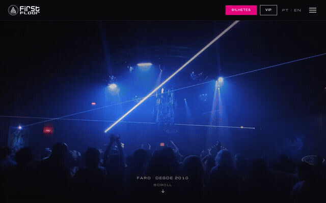

# First Floor Afterdark

An independent nightlife website concept inspired by **First Floor Club, Faro**. A bold, bilingual experience with scroll-driven motion, event posters, weekly nights, a layered gallery, and a multi-step VIP booking interface.

Built by David Correia with **Next.js 16, React 19, Tailwind CSS 4, GSAP, and Lenis**.

## Quick demo

[](demo/afterdark-demo.mp4)

**[Watch or download the short MP4 walkthrough](demo/afterdark-demo.mp4)** · [Desktop preview](demo/desktop.png) · [Phone preview](demo/mobile.png) · [VIP flow](demo/vip-summary.png)

The recording shows the homepage, menu, event sections, and VIP zone/table/contact/summary flow. Its visitor details are synthetic and no booking request was submitted. See [demo/README.md](demo/README.md) for playback and recording instructions.

## Run locally

Requires Node.js 20.9 or later and npm:

```sh
npm ci
npm run build
npm run start -- --port 3100
```

Open **http://localhost:3100/pt** or **http://localhost:3100/en**. For development, run `npm run dev`.

Checks:

```sh
npm run lint
npm run build
```

Next.js serves the VIP routes dynamically. Run it as a Node.js application; this repository is not configured as a static GitHub Pages export.

## Features

- Portuguese and English content.
- A full-screen menu and animated brand hero.
- Event-poster carousel and weekly-night ring.
- Responsive gallery, visibility-aware background loops, and reduced-motion support.
- VIP event selection, zones, tables, contact details, and a generated request summary.
- Touch devices use native scrolling; desktop uses Lenis.

## Project structure

| Path | Purpose |
| --- | --- |
| `app/[lang]/` | Localized homepage and VIP routes |
| `components/` | Navigation, motion sections, gallery, and booking UI |
| `content/site.ts` | Portuguese/English text, club facts, and sample events |
| `content/vip.ts` | Sample zones, tables, pricing, and availability |
| `lib/` | Shared scroll/header helpers |
| `public/` | Credited images, logo, and replacement background loops |
| `demo/` | Recorded walkthrough and selected screenshots |
| `scripts/` | Demo capture, visual review, and image-processing helpers |

## Prototype status and media

This is an **independent design concept**, not the club's official booking system. Events, prices, availability, and the reserved floor-map slot are examples. The newsletter has no subscription backend, and the WhatsApp link is a draft request rather than a confirmed booking.

The public edition excludes the local mockup's YouTube and Mixkit footage/extracted stills. It uses the already-credited Wikimedia Commons photographs and gentle background loops encoded from those images. **[Media attribution and licenses](public/img/CREDITS.md)** apply to those assets, screenshots, and the corresponding portions of the demo recording. The club logo and branding retain their owners' rights; no blanket license for third-party media or branding is implied.

The original local mockup in `../dummy/firstfloor` was preserved. This public edition lives in `../projects/first-floor-afterdark`.
